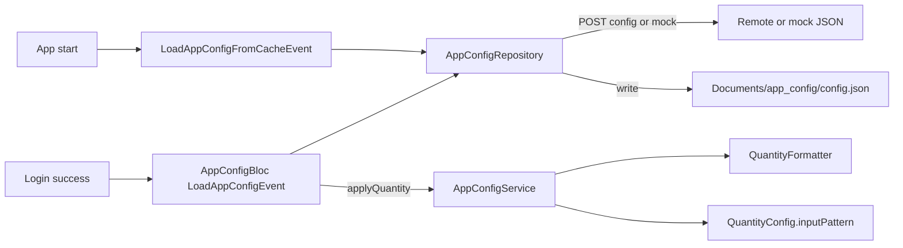

# App Config / Quantity Digits (BS-Mobile)

โมดูลกำหนดจำนวนหลักทศนิยมและหลักจำนวนเต็มของ quantity ทั้งแอพ  
ต้นทาง: [`lib/src/core/app_config/`](../lib/src/core/app_config/)

โหลดจาก API (หรือ mock) → cache บน disk → เก็บใน `AppConfigService`  
UI และ format ใช้ผ่าน `QuantityFormatter` / `QuantityConfig.inputPattern`

Client identity (`platform`, `application_license`) อยู่ที่ [`app_identity.dart`](../lib/src/core/app_identity.dart) — ใช้ร่วมกับ login / locale / config API

---

## Architecture



| Layer                 | หน้าที่                                                 |
| --------------------- | ------------------------------------------------------- |
| `AppConfigBloc`       | สั่งโหลด + **apply** เข้า `AppConfigService`           |
| `AppConfigRepository` | `fetchAndCache` / `readCache` เท่านั้น (ไม่ mutate service) |
| `AppConfigService`    | in-memory singleton (`quantity`)                        |
| `QuantityFormatter`   | display / input / parse / round สำหรับ API              |
| `QuantityConfig`      | ค่า `decimalPlaces`, `maxIntegerDigits`, `inputPattern` |
| `AppIdentity`         | `platform` + `applicationLicense` สำหรับ request body   |

---

## Files

| Path                                                                                  | Role                                       |
| ------------------------------------------------------------------------------------- | ------------------------------------------ |
| [`quantity_config.dart`](../lib/src/core/app_config/quantity_config.dart)             | model + defaults (3 / 10) + `inputPattern` |
| [`app_config_response.dart`](../lib/src/core/app_config/app_config_response.dart)     | DTO จาก API                                |
| [`app_config_service.dart`](../lib/src/core/app_config/app_config_service.dart)       | singleton เก็บ config ปัจจุบัน             |
| [`app_config_repository.dart`](../lib/src/core/app_config/app_config_repository.dart) | fetch + cache + apply                      |
| [`app_config_bloc.dart`](../lib/src/global/blocs/app_config/app_config_bloc.dart)     | events / states                            |
| [`quantity_formatter.dart`](../lib/src/core/helpers/quantity_formatter.dart)          | format / parse / round                     |
| [`app_identity.dart`](../lib/src/core/app_identity.dart)                              | client identity constants                  |

DI: [`injection.dart`](../lib/src/app/di/injection.dart) — `AppConfigBloc` + `AppConfigRepository(ApiClient)`

---

## เมื่อไหร่โหลด

| Timing            | Event                                                                                                     | พฤติกรรม                                       |
| ----------------- | --------------------------------------------------------------------------------------------------------- | ---------------------------------------------- |
| Cold start        | `LoadAppConfigFromCacheEvent` ใน [`app.dart`](../lib/src/app/app.dart)                                    | อ่าน disk → `AppConfigService` (offline-ready) |
| หลัง login สำเร็จ | `LoadAppConfigEvent` จาก [`login_page.dart`](../lib/src/features/auth/presentation/pages/login_page.dart) | fetch → เขียน disk → apply                     |

States: `AppConfigInitial` → `AppConfigLoading` → `AppConfigLoaded` / `AppConfigFailure`

ก่อนมี cache หรือยังไม่ apply: ใช้ `QuantityConfig.defaults` (`decimalPlaces: 3`, `maxIntegerDigits: 10`)

---

## Mock vs API จริง

| Flag                                | ค่า               | ความหมาย                         |
| ----------------------------------- | ----------------- | -------------------------------- |
| `AppConfigRepository.useMockConfig` | `true` (ปัจจุบัน) | โหลดจาก asset mock               |
|                                     | `false`           | `POST 'config'` ผ่าน `ApiClient` |

### Request (เมื่อ `useMockConfig = false`)

```json
{
  "platform": "MOBILE",
  "application_license": "<AppIdentity.applicationLicense>"
}
```

ค่ามาจาก [`AppIdentity`](../lib/src/core/app_identity.dart)

### Fallback เมื่อ API fail

1. อ่าน disk cache (`Documents/app_config/config.json`)
2. ถ้าไม่มี → โหลด mock asset

### Mock asset

- ลงทะเบียนใน `pubspec.yaml`: `lib/src/global/mockdata/app_config_mock.json`
- repository โหลดจาก path เดียวกัน

---

## JSON shape

```json
{
  "message_code": "0",
  "message_text": "Success",
  "quantity": {
    "decimal_places": 3,
    "max_integer_digits": 10
  }
}
```

| Field                           | Type    | ความหมาย                            |
| ------------------------------- | ------- | ----------------------------------- |
| `quantity.decimal_places`       | int ≥ 0 | จำนวนทศนิยม (0 = จำนวนเต็มเท่านั้น) |
| `quantity.max_integer_digits`   | int ≥ 0 | จำนวนหลักก่อนจุดทศนิยมสูงสุด        |
| `message_code` / `message_text` | string? | สถานะจาก API (optional ใน cache)    |

`QuantityConfig.fromJson` ใช้ค่า default ถ้า field หายหรือ parse ไม่ได้

### `inputPattern`

จาก `decimalPlaces` / `maxIntegerDigits` เช่น `decimalPlaces: 3`, `maxIntegerDigits: 10`:

```text
^\d{0,10}(\.\d{0,3})?$
```

ใช้กับ `FilteringTextInputFormatter.allow(...)` ในช่อง quantity

---

## วิธีใช้ใน feature

```dart
import 'package:bs_mobile/src/core/app_config/app_config_service.dart';
import 'package:bs_mobile/src/core/helpers/quantity_formatter.dart';

// แสดงบนจอ — null → "-"
QuantityFormatter.formatDisplay(12.3); // → "12.300" เมื่อ decimalPlaces=3

// ค่าใส่ text field หลัง +/- หรือ set จากโค้ด
QuantityFormatter.formatInput(qty);

// จำกัดการพิมพ์
FilteringTextInputFormatter.allow(
  AppConfigService.instance.quantity.inputPattern,
);

// parse จากช่องกรอก
final value = QuantityFormatter.parse(controller.text);

// ปัดก่อนส่ง API
final payload = QuantityFormatter.roundForApi(value);
```

### CustomQtyStepper (แนะนำสำหรับช่อง quantity)

[`CustomQtyStepper`](../lib/src/shared/ui/widgets/custom_qty_stepper.dart) ใช้ `inputPattern` จาก `AppConfigService` ให้แล้วเมื่อ `useQuantityConfig: true` (default) — feature ไม่ต้องสร้าง regex ทศนิยมเอง

```dart
import 'package:bs_mobile/src/shared/ui/widgets/custom_qty_stepper.dart';

CustomQtyStepper(
  controller: _qtyController,
  onDecrement: () => _setQty(_qty - 1),
  onIncrement: () => _setQty(_qty + 1),
)
```

รายละเอียด widget + ตัวอย่าง parent helper: [SHARED_WIDGETS.md § CustomQtyStepper](SHARED_WIDGETS.md#customqtystepper--quantity)

| เมธอด           | ใช้เมื่อ                               |
| --------------- | -------------------------------------- |
| `formatDisplay` | แสดงผล UI                              |
| `formatInput`   | ตั้งค่าในช่องกรอก                      |
| `parse`         | อ่าน string → `double`                 |
| `roundForApi`   | ปัดตาม `decimalPlaces` ก่อนส่ง backend |

**ห้าม hardcode ทศนิยมใน feature** — อ่านจาก `AppConfigService` / `QuantityFormatter` เสมอ

---

## Disk cache

| Item      | Value                                            |
| --------- | ------------------------------------------------ |
| Directory | `{ApplicationDocumentsDirectory}/app_config/`    |
| File      | `config.json`                                    |
| Write     | หลัง `fetchAndCache()` สำเร็จ (repository)        |
| Read      | `readCache()` หรือ fallback ของ API fail           |
| Apply     | `AppConfigBloc` → `AppConfigService.applyQuantity` |
---

## กฎสำหรับ AI / contributor

1. เปลี่ยนจำนวนทศนิยมผ่าน config ไม่แก้ widget ทีละจุด
2. เพิ่ม field config ใหม่ → อัปเดต `AppConfigResponse` + `AppConfigService` (ถ้าต้องเก็บ in-memory) + doc นี้
3. สลับ API จริง: ตั้ง `useMockConfig = false` และยืนยัน endpoint `config` + request body
4. Feature ห้ามเรียก `ApiClient` เพื่อโหลด config ซ้ำ — ใช้ `AppConfigBloc` / `AppConfigService`
5. Quantity UI ใช้ `QuantityFormatter` + `inputPattern` ไม่สร้าง regex ทศนิยมเอง
6. ค่า `platform` / license ใช้ `AppIdentity` ไม่สร้าง const ซ้ำใน feature

---

## เอกสารที่เกี่ยวข้อง

- [API_CLIENT.md](API_CLIENT.md) — HTTP client / gateway vs localhost
- [ARCHITECTURE.md](ARCHITECTURE.md) — layer และ dependency flow
- [SHARED_WIDGETS.md](SHARED_WIDGETS.md) — [CustomQtyStepper § quantity](SHARED_WIDGETS.md#customqtystepper--quantity)
