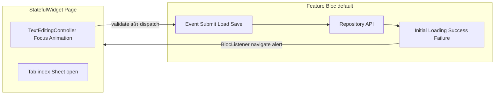

# BLoC Pattern Guide

คู่มือ **วิธีเขียน BLoC** ใน BS-Mobile Flutter Template — สำหรับ dev และ AI ก่อนสร้าง feature ใหม่

ตัวอย่างในเอกสารเป็น baseline ของ template ไม่ได้ผูกกับระบบธุรกิจใดระบบหนึ่ง

กฎ import / ห้าม UI ใน BLoC ดูเพิ่มใน [ARCHITECTURE.md](ARCHITECTURE.md)

---

## สารบัญ

1. [ภาพรวม](#ภาพรวม)
2. [Default: Command BLoC](#default-command-bloc)
3. [อยู่ที่ Widget ไม่ใช่ BLoC](#อยู่ที่-widget-ไม่ใช่-bloc)
4. [Pagination / Load More](#pagination--load-more)
5. [Multi-step Flow: ใช้ State แทน Flag](#multi-step-flow-ใช้-state-แทน-flag)
6. [Exception: Session BLoC](#exception-session-bloc)
7. [Global BLoC](#global-bloc)
8. [Testing](#testing)
9. [Checklist ก่อน PR](#checklist-ก่อน-pr)

---

## ภาพรวม

โปรเจกต์มี BLoC 2 แบบ:

| แบบ                            | ตัวอย่าง                                                                                                                                                                                                      | ใช้เมื่อ                                                          |
| ------------------------------ | ------------------------------------------------------------------------------------------------------------------------------------------------------------------------------------------------------------- | ----------------------------------------------------------------- |
| **Command bloc** _(default)_   | [`features/auth/`](../lib/src/features/auth/presentation/bloc/), [`features/home/`](../lib/src/features/home/presentation/bloc/), [`features/config_url/`](../lib/src/features/config_url/presentation/bloc/) | 1 event = 1 การเรียก repository · state เป็น union สั้น ๆ         |
| **Session bloc** _(exception)_ | [`features/ai/`](../lib/src/features/ai/presentation/bloc/)                                                                                                                                                   | หน้ามี session ยาว · หลาย API · state หลาย field ที่ต้อง sync กัน |

**กฎ default:** feature ใหม่ใช้ **Command BLoC** เท่านั้น — ไม่ copy `AiChatBloc` จนกว่า PR จะระบุว่าเป็น session exception



ตัวอย่างการแยกที่ถูกต้อง: [`login_page.dart`](../lib/src/features/auth/presentation/pages/login_page.dart) — form controllers + animation อยู่ `StatefulWidget` · `AuthBloc` รับแค่ login / logout / refresh

---

## Default: Command BLoC

ใช้กับ business screen ส่วนใหญ่: login, list, submit, confirm, delete line

### โครงสร้างไฟล์

```
features/<name>/presentation/bloc/
├── <name>_bloc.dart      # class + handlers
├── <name>_event.dart     # part of bloc
└── <name>_state.dart     # part of bloc
```

อ้างอิง: [`auth_bloc.dart`](../lib/src/features/auth/presentation/bloc/auth_bloc.dart)

### Equatable (บังคับ)

ทุก **Event** และ **State** ของ command bloc ต้อง `extends Equatable` — import ในไฟล์ `*_bloc.dart`:

```dart
import 'package:equatable/equatable.dart';
```

```dart
// *_event.dart (part of bloc)
sealed class FeatureEvent extends Equatable {
  const FeatureEvent();
  @override
  List<Object?> get props => [];
}

final class SubmitEvent extends FeatureEvent {
  const SubmitEvent(this.data);
  final SubmitRequest data;
  @override
  List<Object?> get props => [data];
}
```

```dart
// *_state.dart (part of bloc)
sealed class FeatureState extends Equatable {
  const FeatureState();
  @override
  List<Object?> get props => [];
}

final class FeatureLoading extends FeatureState {
  const FeatureLoading();
}

final class FeatureSuccess extends FeatureState {
  const FeatureSuccess(this.data);
  final ResponseModel data;
  @override
  List<Object?> get props => [data];
}
```

กฎ:

- ใช้ `const` constructor เมื่อเป็นไปได้
- `props` ใส่เฉพาะ field ที่มีค่า (state ว่าง → `props => []`)
- ห้ามใช้ `@immutable` จาก `meta` แทน Equatable
- model ใน `props` ไม่จำเป็นต้อง extends Equatable — แต่ถ้าเทียบใน `blocTest` ใช้ `equals` ได้ง่ายขึ้นถ้า model เป็น Equatable ด้วย

### Event

- ชื่อเป็นคำสั่งที่ **trigger การเรียก repository**
- ตัวอย่าง: `AuthLoginEvent`, `FetchMenuEvent`, `ConnectionTestRequested`
- ห้ามสร้าง event สำหรับ UI ล้วน ๆ (เปิด dialog, เปลี่ยน tab) ถ้าไม่เรียก API

### State

Union สั้น ๆ — ไม่ใช้ `copyWith` ยกเว้น session exception:

| State      | ความหมาย                      |
| ---------- | ----------------------------- |
| `*Initial` | ยังไม่ได้ทำอะไร               |
| `*Loading` | กำลังเรียก repository         |
| `*Success` | สำเร็จ — แนบ data model ถ้ามี |
| `*Failure` | ล้มเหลว — แนบ message         |

ตัวอย่างเพิ่มเติม: `AuthLogout` สำหรับ side-effect หลัง logout สำเร็จ (ยังเป็น union ไม่ใช่ UI flag)

### Handler pattern

```dart
Future<void> _onSubmit(
  SubmitEvent event,
  Emitter<FeatureState> emit,
) async {
  emit(FeatureLoading());
  final result = await _repository.submit(event.data);
  if (result.messageCode == '0') {
    emit(FeatureSuccess(data: result));
  } else {
    emit(FeatureFailure(result.messageText ?? 'Submit failed'));
  }
}
```

### ห้ามใน BLoC

- import `CustomShowAlert`, `CustomLoading`, `go_router`
- `context.go` / `showDialog` / navigate
- เก็บ tab index, dialog open, scroll position, `TextEditingController`

Side-effect UI อยู่ **`BlocListener` ใน page** เท่านั้น (ดู login page)

---

## อยู่ที่ Widget ไม่ใช่ BLoC

| อยู่ที่ Page / Widget                  | อยู่ที่ BLoC                             |
| -------------------------------------- | ---------------------------------------- |
| `TextEditingController`, `FocusNode`   | —                                        |
| `AnimationController`, `TabController` | —                                        |
| เปิด/ปิด bottom sheet, dialog (local)  | —                                        |
| UI-level validation (required, format, `Form.validate()`) | —                    |
| business-rule validation ที่พึ่งข้อมูลจาก repository/response (limit ตาม quantity คงเหลือ, เงื่อนไข lot/serial/expiry control, สิทธิ์การทำรายการ) | ต้องอยู่ bloc/validator — dispatch event ให้ bloc ตัดสินและ emit state ผลลัพธ์ |
| แสดง alert / navigate หลัง state       | emit `Success` / `Failure` เท่านั้น      |
| —                                      | เรียก repository + emit loading / result |
| —                                      | pagination / load-more แบบ business flow (default: Bloc; ดู [Pagination](#pagination--load-more)) |

> **หลักแยก:** ถ้า validate โดยไม่ต้องรู้ข้อมูลจาก server (แค่เช็ค empty/format) → widget พอ ถ้า validate ต้องอ้างอิงข้อมูลธุรกิจที่มาจาก API (เช่น `quantityRemain`, `lotControl`, `snControl`) → ต้องอยู่ bloc/validator เพราะเป็น business rule ไม่ใช่ UI rule ล้วนๆ — ห้ามคำนวณ/ตัดสินเงื่อนไขพวกนี้ซ้ำใน widget เพราะจะ sync กับ bloc state ไม่ตรงกันเมื่อ flow ซับซ้อนขึ้น

Flow มาตรฐาน:

1. User กรอกฟอร์ม → controller ใน `StatefulWidget`
2. กด submit → `Form.validate()` ใน page (UI-level เท่านั้น)
3. ผ่านแล้ว → `bloc.add(SubmitEvent(data))`
4. Bloc ตรวจ business rule (ถ้ามี) ก่อนเรียก repository จริง แล้ว emit state ผลลัพธ์
5. `BlocListener` ฟัง `Success` / `Failure` → alert + `context.go(...)`

---

## Pagination / Load More

Pagination มี 2 pattern ที่รองรับ และต้องเลือก owner เพียงตัวเดียว:

| Pattern | ใช้เมื่อ | Owner ของ items/page/loading/error |
| --- | --- | --- |
| **Command BLoC (default)** | pagination ผูกกับ business validation, permission, multi-step flow หรือ state อื่นของ feature | Bloc State |
| **`PagedListController` exception** | หน้า list/search/refresh ทั่วไปที่ไม่มี business flow ซับซ้อน | `PagedListController` |

ห้ามแก้ปัญหาด้วยการให้ widget เรียก repository แบบ ad hoc แล้วเก็บ `_list` / `_pageNumber` เอง ไม่ว่าจะเลือก pattern ใด

```dart
// ❌ ห้าม: widget เรียก repository ตรงเพื่อโหลดหน้าถัดไป แล้วจัดการ list/page เอง
Future<void> _loadNextPage() async {
  final response = await context.read<XxxBloc>().xxxRepository.fetchList(...);
  setState(() {
    _list.addAll(response.data);
    _pageNumber++;
  });
}
```

```dart
// ✅ ถูก: pagination เป็น event ปกติ, state เก็บ list + page info ให้ครบ
final class FetchListEvent extends FeatureEvent {
  const FetchListEvent({required this.pageNumber, this.searchText});
  final int pageNumber;
  final String? searchText;
  @override
  List<Object?> get props => [pageNumber, searchText];
}

final class ListLoaded extends FeatureState {
  const ListLoaded({
    required this.items,
    required this.pageNumber,
    required this.totalPages,
  });
  final List<ItemModel> items;   // accumulated list พร้อม dedupe แล้วใน bloc
  final int pageNumber;
  final int totalPages;
  @override
  List<Object?> get props => [items, pageNumber, totalPages];
}
```

Bloc handler รับผิดชอบทั้ง merge/dedupe list และ track `pageNumber`/`totalPages` — widget แค่อ่านจาก `ListLoaded.items` แล้ว render พร้อมยิง `FetchListEvent(pageNumber: state.pageNumber + 1)` ตอน scroll ถึงท้ายลิสต์

### Exception: `PagedListController`

ใช้ shared controller ตาม [PAGING.md](PAGING.md) ได้เมื่อเป็น simple list flow:

- page สร้าง controller ใน `initState` และ dispose ใน `dispose()`
- `PagedLoader` เป็นจุดเดียวที่เรียก repository และ map ผลเป็น `PagedResult<T>`
- controller เก็บ items/page/loading/error; page ห้ามมี field ชุดเดียวกันซ้ำ
- ห้ามเรียก repository จาก scroll/search callback นอก loader
- ถ้าเริ่มมี business rule หรือ state ที่ต้อง sync กับ flow อื่น ให้ย้ายกลับไปใช้ Command BLoC

---

## Multi-step Flow: ใช้ State แทน Flag

หน้าที่มีหลายขั้นตอนต่อกัน (เช่น validate item ก่อน แล้วค่อย save) มักถูกแก้ด้วยการเก็บ `bool` ไว้จำ step ใน widget — **ห้ามทำแบบนี้** เพราะ bool ไม่บอกว่า "รออะไรอยู่" และ sync กับ bloc state จริงพลาดง่าย

```dart
// ❌ ห้าม: ใช้ bool จำ step ของ flow ไว้ใน widget
bool _pendingItemValidation = false;
bool _pendingPickSave = false;

// แล้วมาเช็คใน BlocListener ทีหลังว่า flag ไหนเป็น true
```

```dart
// ✅ ถูก: ให้แต่ละ step มี state ของตัวเอง ระบุชัดว่ากำลังทำอะไร
sealed class PickState extends Equatable { ... }

final class ItemValidating extends PickState {}
final class ItemValidated extends PickState {
  final ItemModel item;
}
final class ItemValidationFailed extends PickState {
  final String message;
}
final class PickSaving extends PickState {}
final class PickSaved extends PickState {
  final SaveResponse response;
}
```

Widget ฟัง state ผ่าน `BlocListener`/`BlocBuilder` แล้ว `switch` ตาม type — ไม่ต้องมี `bool` คู่ขนานมาช่วยจำเลย เพราะ state ของ bloc **คือ** source of truth ของ step ปัจจุบันอยู่แล้ว

---

## Exception: Session BLoC

ใช้เฉพาะเมื่อหน้ามี **state หลาย field ที่ sync กับหลาย API** ในหน้าเดียว

ตัวอย่าง: [`AiChatBloc`](../lib/src/features/ai/presentation/bloc/ai_chat_bloc.dart)

- state เดียว + `copyWith` (messages, isSending, suggestions, …)
- หลาย event: send, confirm proposal, load suggestions

**ห้าม** ใช้ pattern นี้กับ:

- หน้า list + กด refresh
- ฟอร์ม submit ครั้งเดียว
- CRUD ธรรมดาใน feature ทั่วไป

ถ้าต้องใช้ session bloc → ระบุใน PR ว่าทำไม command bloc ไม่พอ

> หน้าที่มีหลาย step ต่อกัน (เช่น validate → save ใน [Multi-step Flow](#multi-step-flow-ใช้-state-แทน-flag)) **ไม่จำเป็นต้องเปลี่ยนเป็น session bloc** — ใช้ command bloc + sealed state ที่ระบุ step ได้ก็เพียงพอ ไม่ต้องพึ่ง `copyWith` เว้นแต่ field ที่ต้อง sync กันจริงๆ มีจำนวนมากและซับซ้อนแบบ session

---

## Global BLoC

BLoC แอพ-wide อยู่ที่ `global/blocs/` — **ไม่ใช่ template ของ feature ใหม่**

| ตัวอย่าง      | บทบาท                |
| ------------- | -------------------- |
| `ThemeBloc`   | dark mode + palette  |
| `NetworkBloc` | connectivity         |
| `VersionBloc` | check / download APK |
| `LocaleBloc`  | i18n load            |
| `BluetoothBloc` | connectivity stub — **`registerLazySingleton`** (class เป็น process singleton) |

Global infrastructure BLoC บางตัวยังเป็น plain `abstract class` (ไม่ sealed/Equatable) — ข้อยกเว้นที่ยอมรับได้จนกว่าจะ migrate; **feature BLoC ใหม่ต้อง sealed + Equatable**

Feature ใหม่วาง bloc ที่ `features/<name>/presentation/bloc/` เสมอ

**UI side effects:** ใช้ `BlocListener` ที่ page / `AppBlocListeners` — ห้าม SnackBar/dialog ใน repository หรือ core adapter

**Persistence:** ผ่าน repository (หรือ documented owner ใน BLoC เช่น `NetworkBloc.setNetwork`) — ห้าม presentation เรียก `AppStorage` setter

---

## Testing

อ้างอิง: [`config_url_bloc_test.dart`](../test/src/features/config_url/presentation/bloc/config_url_bloc_test.dart)

```dart
blocTest<ConfigUrlBloc, ConfigUrlState>(
  'emits [Loading, Success] when connection succeeds',
  build: () {
    when(() => repository.testConnection(any()))
        .thenAnswer((_) async => true);
    return ConfigUrlBloc(repository);
  },
  act: (bloc) => bloc.add(const ConnectionTestRequested(testUrl)),
  expect: () => const [
    ConfigUrlLoading(),
    ConfigUrlSuccess('Connection Server Success'),
  ],
  verify: (_) {
    verify(() => repository.testConnection(testUrl)).called(1);
  },
);
```

ใช้ **bloc_test** + **mocktail** · mock repository · verify เรียก API ครบและ emit ลำดับ state ถูกต้อง

Pagination และ multi-step flow ก็ควร test ลำดับ state เหมือนกัน เช่น:

```dart
blocTest<PickBloc, PickState>(
  'emits [ItemValidating, ItemValidated] when item is valid',
  build: () => PickBloc(repository),
  act: (bloc) => bloc.add(ValidateItemEvent(itemNumber: 'A001')),
  expect: () => [
    ItemValidating(),
    isA<ItemValidated>(),
  ],
);
```

---

## Checklist ก่อน PR

- [ ] Event / State **extends Equatable** + `props` ครบ
- [ ] Feature ใหม่ใช้ **command bloc** (ยกเว้นระบุ session exception)
- [ ] Event แต่ละตัว map กับ repository call
- [ ] ไม่มี UI state ใน bloc (tab, dialog, controller)
- [ ] Alert / loading / navigate อยู่ `BlocListener` ใน page
- [ ] BLoC ไม่ import UI widgets หรือ routing
- [ ] business-rule validation (ที่พึ่งข้อมูลจาก API) อยู่ bloc/validator ไม่ใช่ widget
- [ ] Pagination มี owner เดียว: Bloc State (default) หรือ `PagedListController` exception — page ไม่เก็บ list/page ซ้ำและไม่เรียก repository นอก `PagedLoader`
- [ ] Flow หลาย step ใช้ sealed state แทน `bool` flag ที่เก็บใน widget
- [ ] มี bloc test อย่างน้อย happy path + failure (ถ้ามี bloc)

---

## เอกสารที่เกี่ยวข้อง

- [README.md](../README.md) — AI Developer Guide, Conventions
- [SHARED_WIDGETS.md](SHARED_WIDGETS.md) — widget catalog
- [ARCHITECTURE.md](ARCHITECTURE.md) — layer, import rules, วาง bloc ที่ไหน

### Prompt สั้น ๆ สำหรับ AI

```text
Implement feature ตาม mockup UX
Bloc: docs/BLOC_PATTERN.md — command pattern แบบ features/auth/
UI state อยู่ page ไม่ใส่ bloc
Business-rule validation และ multi-step flow อยู่ bloc; simple pagination ใช้ PagedListController exception ได้ (ดู BLOC_PATTERN.md)
```
