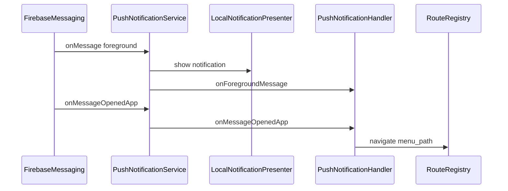

# FCM Push Notification Integration (BS-Mobile)

Mobile รับ push notification ผ่าน **Firebase Cloud Messaging (FCM)** — โมดูลอยู่ที่ `lib/src/core/push_notification/`

ค่า config Firebase (API keys, `google-services.json`, `GoogleService-Info.plist`) **ไม่ commit ใน git** — ใส่ทีหลังตามขั้นตอนด้านล่าง

---

## Architecture

```
FirebaseMessaging (FCM)
    → PushNotificationService
        → LocalNotificationPresenter (foreground display)
        → PushNotificationHandler (callbacks — no UI in core)
        → PushNotificationRepository (register token — stub endpoint)
        → AppStorage (fcm_token cache)

PushNotificationBloc (app-wide state)
AppBlocListeners → RouteRegistry.navigateFromMenu (tap deep link)
```

### Message flows

| App state | Behaviour |
| --- | --- |
| **Foreground** | `onMessage` → local notification + `onForegroundMessage` callback |
| **Background** | `fcmBackgroundHandler` → local notification |
| **Terminated (tap)** | `getInitialMessage` / `onMessageOpenedApp` → navigate if `menu_path` in data |



---

## Files

| Path | Role |
| --- | --- |
| `lib/src/core/push_notification/push_notification_config.dart` | Channel id, enable flag, API paths |
| `lib/src/core/push_notification/firebase_initializer.dart` | Optional Firebase init |
| `lib/src/core/push_notification/push_notification_service.dart` | Orchestrator |
| `lib/src/core/push_notification/local_notification_presenter.dart` | `flutter_local_notifications` |
| `lib/src/core/push_notification/push_notification_handler.dart` | Callback registry |
| `lib/src/core/push_notification/push_notification_repository.dart` | Register/unregister token via `ApiClient` |
| `lib/src/core/push_notification/fcm_background_handler.dart` | Background isolate handler |
| `lib/src/core/push_notification/models/push_notification_payload.dart` | Normalized payload |
| `lib/src/global/blocs/push_notification/` | `PushNotificationBloc` |
| `lib/main.dart` | Registers `onBackgroundMessage` |
| `lib/src/app/bootstrap.dart` | Early init when enabled |
| `lib/src/app/di/app_bloc_listeners.dart` | Tap → navigation |

---

## Prerequisites

1. [Firebase project](https://console.firebase.google.com/)
2. [FlutterFire CLI](https://firebase.flutter.dev/docs/cli/) (แนะนำ)

```bash
dart pub global activate flutterfire_cli
flutterfire configure
```

3. เปิด **Cloud Messaging** ใน Firebase Console

---

## Android setup

### 1. สร้าง Android app ใน Firebase

- Package name: `app.bsmobile.businessolution` (ตรงกับ `applicationId` ใน `android/app/build.gradle`)

### 2. วาง config file

```powershell
# Windows — copy จาก Firebase Console หรือหลัง flutterfire configure
Copy-Item android\app\google-services.json.example android\app\google-services.json
# แก้ค่าจริงใน google-services.json
```

Gradle จะ apply `com.google.gms.google-services` **อัตโนมัติ** เมื่อไฟล์มีอยู่ (`android/app/build.gradle`).

### 3. Permissions

มีใน `AndroidManifest.xml` แล้ว:

- `POST_NOTIFICATIONS` (Android 13+)
- `WAKE_LOCK`, `VIBRATE`, `RECEIVE_BOOT_COMPLETED`

Runtime permission ขอผ่าน `permission_handler` ใน `PushNotificationService`.

### 4. Default notification channel

Manifest meta-data:

- `com.google.firebase.messaging.default_notification_channel_id` = `bs_mobile_default`
- ตรงกับ `PushNotificationConfig.androidChannelId`

---

## iOS setup

### 1. สร้าง iOS app ใน Firebase

- Bundle ID ต้องตรงกับ Xcode project

### 2. วาง config file

```bash
cp ios/Runner/GoogleService-Info.plist.example ios/Runner/GoogleService-Info.plist
# แก้ค่าจริง หรือใช้ไฟล์จาก Firebase Console
```

### 3. APNs key

1. Apple Developer → Keys → สร้าง APNs Authentication Key
2. อัปโหลด `.p8` ใน Firebase Console → Project Settings → Cloud Messaging → Apple app configuration

### 4. Xcode capabilities

เปิด `ios/Runner.xcworkspace` ใน Xcode:

1. Target **Runner** → **Signing & Capabilities**
2. **+ Capability** → **Push Notifications**
3. **+ Capability** → **Background Modes** → ติ๊ก **Remote notifications**

`Info.plist` มี `UIBackgroundModes` → `remote-notification` แล้ว

### 5. ทดสอบบนเครื่องจริง

Push notification บน iOS Simulator จำกัด — ใช้ physical device

---

## เปิดใช้งานในแอพ

ค่าเริ่มต้น: **FCM ปิด** (แอพ build/run ได้โดยไม่มี Firebase config)

เปิดเมื่อ setup native config เสร็จ:

```bash
flutter run --dart-define=ENABLE_FCM=true
```

```bash
flutter build apk --release --dart-define=ENABLE_FCM=true
```

Flag อ่านจาก `PushNotificationConfig.enabled` (`bool.fromEnvironment('ENABLE_FCM')`).

---

## ทดสอบ

### 1. ตรวจ FCM token

หลัง login + เปิด FCM:

- ดู debug log จาก `PushNotificationBloc` state `PushNotificationReady`
- อ่านจาก `AppStorage.getFcmToken()`

### 2. ส่งข้อความทดสอบ

Firebase Console → **Engage** → **Messaging** → **Create campaign** → **Firebase Notification messages**

ใส่ title/body แล้วเลือก app `app.bsmobile.businessolution`

### 3. Deep link payload

ส่ง **data** payload (หรือรวมกับ notification):

```json
{
  "menu_path": "/home"
}
```

รองรับ keys: `menu_path`, `route`, `path`

แตะ notification → `RouteRegistry.navigateFromMenu`

---

## Register token กับ backend (ทำทีหลัง)

Stub endpoint ใน `PushNotificationConfig`:

| Action | Path |
| --- | --- |
| Register | `mobile/fcm/register` |
| Unregister | `mobile/fcm/unregister` |

### Register request (ตัวอย่าง)

```json
POST {gateway}/mobile/fcm/register
Authorization: Bearer {jwt}

{
  "fcm_token": "device-fcm-token",
  "user_id": "user-id-from-jwt",
  "platform": "android"
}
```

เรียกอัตโนมัติหลังได้ token และเมื่อ `onTokenRefresh`  
แนะนำ wire เพิ่มใน `AuthRepository.login` / `logout` เมื่อ API พร้อม

### Unregister

เรียก `PushNotificationService.unregister()` หรือ dispatch `PushNotificationUnregister` ใน bloc ตอน logout

---

## Payload convention

| Field | ใช้เมื่อ |
| --- | --- |
| `title` | หัวข้อ notification (หรือใช้ notification block ของ FCM) |
| `body` | เนื้อหา |
| `menu_path` | deep link ไป route ที่ลงทะเบียนใน `RouteRegistry` |
| `route` / `path` | alias ของ `menu_path` |

---

## Troubleshooting

| ปัญหา | แนวทาง |
| --- | --- |
| แอพ crash ตอน init | ตรวจ `google-services.json` / `GoogleService-Info.plist` ถูก package/bundle |
| ไม่ได้ FCM token | เปิด `--dart-define=ENABLE_FCM=true`, ตรวจ internet, Google Play Services (Android) |
| Foreground ไม่เห็น notification | ตรวจ POST_NOTIFICATIONS granted (Android 13+) |
| iOS ไม่ได้ push | ตรวจ APNs key ใน Firebase, Push capability ใน Xcode, ทดสอบบน device จริง |
| Tap แล้วไม่ navigate | ตรวจ data มี `menu_path` และ path อยู่ใน `RouteRegistry.registeredPaths` |
| Build ล้มเหลวไม่มี google-services | ปกติ — plugin apply เฉพาะเมื่อมีไฟล์; หรือปิด FCM flag |

---

## กฎสำหรับ feature developers

1. **ห้าม** import `firebase_messaging` จาก feature โดยตรง
2. ใช้ `PushNotificationHandler` callbacks หรือ `PushNotificationBloc` state
3. UI side-effects (navigate, alert) อยู่ที่ `AppBlocListeners` / page listeners
4. อย่า commit `google-services.json`, `GoogleService-Info.plist`, `firebase_options.dart`
