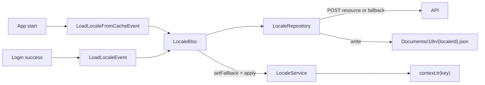

# Locale / i18n (BS-Mobile)

API-driven locale strings with **JSON file cache** as the only persistence strategy.

---

## Components

| Piece | Path | Role |
|-------|------|------|
| `LocaleRepository` | `lib/src/core/localization/locale_repository.dart` | Fetch / read / write disk cache; returns DTOs |
| `LocaleBloc` | `lib/src/global/blocs/locale/locale_bloc.dart` | Owns apply into `LocaleService` |
| `LocaleService` | `lib/src/core/localization/locale_service.dart` | In-memory singleton for `tr()` |
| `context.tr()` | `lib/src/core/localization/locale_extension.dart` | Widget helper |

SQLite `locale_resource` table/DAO was removed — do not reintroduce a second cache without migrating all read/write paths.

---

## Flow



1. Repository `fetchAndCache()` / `readCache()` / `loadFallbackMessages()` — no runtime singleton mutation except via returned data.
2. `LocaleBloc` calls `LocaleService.setFallback` then `apply`.
3. Pages read via `context.tr('key')` or `LocaleService.instance.tr(...)`.

---

## UI string contract

ข้อความที่ผู้ใช้มองเห็นต้องมี key ที่ stable และมี namespace ตาม feature/page
โดยใช้ชื่อแบบ `page.semantic_name` หรือ `feature.semantic_name` เช่น
`login.title`, `login.username`, `login.submit` และใช้ `common.*` สำหรับคำที่ใช้ร่วมกันทุกหน้า
ใช้ชื่อภาษาอังกฤษแบบ lowercase `snake_case` ที่สื่อความหมายและคงที่ ไม่ผูกกับข้อความแปลของภาษาใดภาษาหนึ่ง

เรียกใช้ใน presentation ด้วย `context.tr` พร้อม fallback ที่เป็นข้อความแสดงผลจริง:

```dart
AppText(
  context.tr(
    'login.submit',
    fallback: 'เข้าสู่ระบบ',
  ),
)
```

กฎนี้ใช้กับ `AppText`, `Text`, `labelText`, `hintText`, ปุ่ม, validation,
dialog, snackbar, tooltip, empty state และ loading copy
โดย `AppText` รับข้อความที่แปลแล้วจากจุดเรียกใช้ ไม่สร้างระบบแปลซ้ำภายใน widget กลาง

ข้อความที่มีค่าผันแปรให้ใช้ `params` แทนการต่อข้อความเอง:

```dart
context.tr(
  'download.progress',
  fallback: 'กำลังดาวน์โหลด {percent}%',
  params: {'percent': '50'},
)
```

ไม่ต้องส่งข้อความ technical เช่น route path, API/JSON key, enum/code, asset path,
log, test key หรือข้อความข้อมูลจาก server เข้า localization เว้นแต่ server จะส่ง localization key มาโดยตรง

ก่อนเพิ่ม Model หรือ helper ที่เกี่ยวกับ locale ให้ค้นหา implementation เดิมก่อน และคง
`LocaleRepository` → `LocaleBloc` → `LocaleService` เป็น ownership chain เดิม

---

## Persistence

| Concern | Owner |
|---------|-------|
| Disk JSON cache | `LocaleRepository` |
| Active locale id key | `AppStorage.getLocaleId` / `setLocaleId` (set on login) |
| Runtime messages | `LocaleService` via `LocaleBloc` |

---

## Error / fallback

- API failure → try disk cache → else mock asset load (dev/fallback path in repository).
- Missing keys resolve through `_fallback` map then the raw key string.
- Cold start: `LoadLocaleFromCacheEvent` from `App` bootstrap.

---

## Related

- [ARCHITECTURE.md](ARCHITECTURE.md) — layer rules
- [APP_CONFIG.md](APP_CONFIG.md) — similar fetch/cache/apply pattern for quantity config
